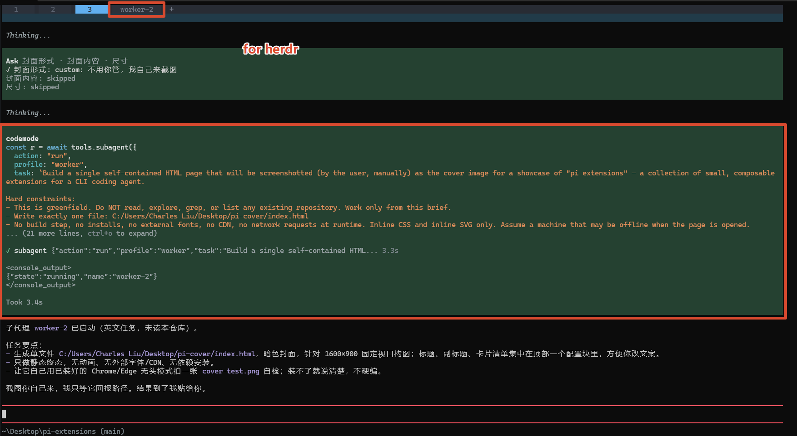

# pi-herdr-subagents-lite



English | [简体中文](README.zh-CN.md)

Run each subagent as a separate pi process in its own herdr tab. One tool, four actions: `spawn`, `steer`, `inspect`, `stop`. Results arrive later as messages. The contract is [spec 0002](docs/specs/0002_v2_architecture_spec.md).

## Features

- A subagent is a separate pi process in a herdr tab, so a human can take the pane over at any time.
- `spawn` returns at once. When the child settles, its answer arrives as one `followUp` message. Settlements inside `aggregateWindowMs` merge into one message, and an oversize answer spills to `output.md`.
- Depth is capped at one. A child registers only `request_input`; it cannot spawn grandchildren.
- A child's question is recorded in `result.json`, never shown as a dialog in its pane. The parent either answers with `steer` or batches several children's questions into one `ask` call for you.
- `worktree: true` gives a child its own checkout, so parallel writers never fight over the repository.
- Zero UI rendering and zero per-turn context injection: the main session's prefix cache stays intact.
- It talks to herdr over the local Socket, not through CLI subprocesses. The only polling is startup readiness: `agent.get` every 100ms until `interactive_ready`, capped at 30s (DEC-0073).

## Install

```bash
pi install npm:pi-herdr-subagents-lite              # npm
pi install /path/to/pi-herdr-subagents-lite         # local checkout
pi -e /path/to/pi-herdr-subagents-lite/src/index.ts # this process only
```

Do not pass `-l`: it writes project settings only, so a child started elsewhere never loads the package.

Requires Node `>= 22.19`. Tested with herdr `0.9.5` and pi `1.6.1`. The parent must run inside a herdr pane, otherwise the tool returns `not_in_herdr`.

Upgrade with `pi update --extensions`, remove with `pi remove <source>`.

## Configuration

One global file: `<agent-dir>/pi-herdr-subagents-lite/config.json`. `<agent-dir>` defaults to `~/.pi/agent` and follows `PI_CODING_AGENT_DIR`. There is no project config. A missing file means all defaults.

```jsonc
{
  // Default true. false = no subagent tool.
  "enabled": true,
  // Default "subagent". Must match ^[a-z][a-z0-9_]{0,31}$.
  "toolName": "subagent",
  // Default ["ask"]. Comma-joined into --exclude-tools; [] sends no flag. Patterns like "mcp__*" work.
  "excludeTools": ["ask"],
  // Default 16, range 1..64. At the limit spawn and steer return max_concurrent.
  "maxConcurrent": 16,
  // Default 2000, range 200..100000 characters. A longer answer spills to output.md.
  "summaryMaxChars": 2000,
  // Default 500, range 0..10000 ms. 0 = deliver each result at once.
  "aggregateWindowMs": 500,
  // Default 3000, range 100..60000 ms. No idle after esc within this window = close the pane and reopen it.
  "interruptGraceMs": 3000,
  // Default ["quit", "reload"]. Values: new, resume, fork, quit, reload.
  "closeChildrenOn": ["quit", "reload"],
  // Default 2592000000 (30 days), range 0..31536000000 ms. 0 = never prune.
  "runRetentionMs": 2592000000
}
```

Strict JSON, read once at load. An unknown key, a wrong type or an out-of-range number stops the extension at load with one message naming every problem.

## Usage

Start `pi` in a herdr pane, then let the model call the tool:

```json
{"action":"spawn","id":"alpha","objective":"Read README.md and answer with its first heading."}
```

The call returns at once with `{"id":"alpha","status":"running","paneId":"w3:p2","sessionFile":"<agent-dir>/pi-herdr-subagents-lite/runs/alpha/session.jsonl"}`. Later a `[subagent alpha] done` message arrives. Do not wait for it in the same turn.

```json
{"action":"steer","id":"alpha","message":"Also check the Windows branch."}
{"action":"inspect","id":"alpha"}
{"action":"stop","id":"alpha"}
```

- `steer` on a running child interrupts its current turn with `esc`, waits for idle, then sends the message.
- `inspect` is the only progress query. It injects nothing into context until you ask.
- `stop` is idempotent and closes the pane.

### spawn parameters

| Field | Meaning |
|---|---|
| `id` | `^[a-z][a-z0-9_-]{0,31}$`, unique per parent session. It is also the herdr agent name and the run directory name. |
| `objective` | The task text. |
| `context` | Optional background, appended as a `# Context` section. |
| `cwd` | Optional working directory. `~` expands. |
| `worktree` | `true` = create a worktree and run there. |
| `tools` `skills` `model` `thinking` | Passed straight to the child's `pi` argv. |

Error codes: `invalid_id`, `duplicate_id`, `unknown_id`, `max_concurrent`, `not_ready`, `cancelled`, `spawn_failed`, `steer_failed`, `not_in_herdr`.

### Where files land

`<agent-dir>/pi-herdr-subagents-lite/runs/<id>/` holds `session.jsonl`, `result.json` and, when the answer is long, `output.md`. Directories older than `runRetentionMs` are pruned at session start.

## Credits

| Project | Borrowed |
|---|---|
| [earendil-works/pi](https://github.com/earendil-works/pi) | Extension API, package layout, official examples |
| [fyang93/pi-herdr-subagents](https://github.com/fyang93/pi-herdr-subagents) | Integration tests on an isolated herdr session |
| [modem-dev/pi-herdr-subagents](https://github.com/modem-dev/pi-herdr-subagents) | herdr launch and lifecycle |
| [purboo/pi-durable-subagents](https://github.com/purboo/pi-durable-subagents) | Async delivery, idempotency, report-once results |

## Tests

```bash
pnpm check     # lint + import graph + tsc + unit tests
pnpm test:e2e  # real machine: isolated herdr session + temp agent dir; needs herdr, pi and auth.json
```

`test:e2e` stays out of `pnpm check`. The whole suite is skipped when `herdr`, `pi` or `~/.pi/agent/auth.json` is missing; `PI_E2E_KEEP=1` keeps the temp directory and `PI_E2E_MODEL` overrides the child model.

## Docs

| Document | Content |
|---|---|
| [ARCHITECTURE](docs/ARCHITECTURE.md) | Module boundaries, dependency direction, test seams |
| [GLOSSARY](docs/GLOSSARY.md) | The only source for terms |
| [Modules](docs/modules/) | Usage and trade-offs per module |
| [Decisions](docs/decisions/) | One file per decision |
| [Spec](docs/specs/0002_v2_architecture_spec.md) | The v2 contract |
| [Research](docs/research/) | Measurements of herdr and pi |
| [CHANGELOG.md](CHANGELOG.md) | Release notes |

## License

MIT, see [LICENSE](LICENSE).
