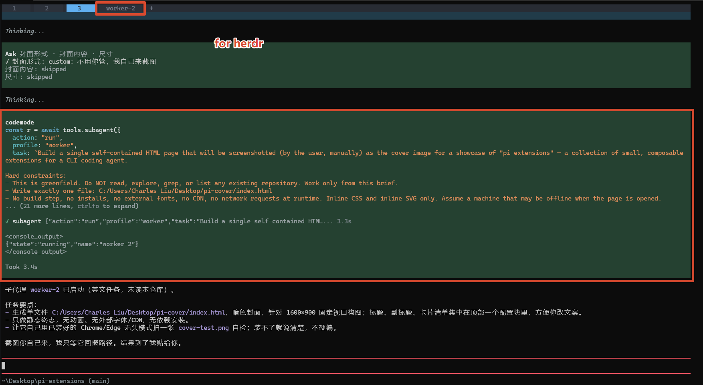

# pi-herdr-subagents-lite



[English](README.md) | 简体中文

每个子代理是一个独立的 pi 进程，跑在自己的 herdr tab 里。只有一个工具、四个动作：`spawn`、`steer`、`inspect`、`stop`。结果稍后作为消息回来。契约见 [spec 0002](docs/specs/0002_v2_architecture_spec.md)。

## 特性

- 子代理是独立 pi 进程，跑在 herdr tab 里，人随时可以接管那个 pane。
- `spawn` 立即返回。子代理结算后答案作为一条 `followUp` 消息回来。`aggregateWindowMs` 内的多条结算合并成一条，超长答案落到 `output.md`。
- 深度上限为 1。子代理只注册 `request_input`，不能再派生子代理。
- 子代理的提问写进 `result.json`，不在自己 pane 里弹对话框。主代理要么用 `steer` 回答，要么把几个子代理的问题合并成一次 `ask` 问你。
- `worktree: true` 给子代理独立 checkout，并行写代码不会互相踩。
- 零 UI 渲染、零每轮上下文注入：主会话前缀 KV Cache 保持完整。
- 走 herdr 本地 Socket，不起 CLI 子进程，也不轮询。

## 安装

```bash
pi install npm:pi-herdr-subagents-lite              # npm
pi install /path/to/pi-herdr-subagents-lite         # 本地检出
pi -e /path/to/pi-herdr-subagents-lite/src/index.ts # 只对本次进程生效
```

不要加 `-l`：它只写项目设置，在别处启动的子进程就不会加载本包。

需要 Node `>= 22.19`。已在 herdr `0.9.5` 与 pi `1.4.0` 上验证。父代理必须在 herdr pane 里运行，否则工具返回 `not_in_herdr`。

升级用 `pi update --extensions`，卸载用 `pi remove <source>`。

## 配置

只有一个全局文件：`<agent-dir>/pi-herdr-subagents-lite/config.json`。`<agent-dir>` 默认 `~/.pi/agent`，跟随 `PI_CODING_AGENT_DIR`。没有项目配置。文件不存在即全默认值。

```jsonc
{
  // 默认 true。false = 不注册子代理工具。
  "enabled": true,
  // 默认 "subagent"。须匹配 ^[a-z][a-z0-9_]{0,31}$。
  "toolName": "subagent",
  // 默认 ["ask"]，逗号拼进 --exclude-tools，[] 表示不传该参数。可写 "mcp__*" 这类模式。
  "excludeTools": ["ask"],
  // 默认 16，范围 1..64。到上限时 spawn 与 steer 返回 max_concurrent。
  "maxConcurrent": 16,
  // 默认 2000，范围 200..100000 字符。超出落 output.md。
  "summaryMaxChars": 2000,
  // 默认 500，范围 0..10000 毫秒。0 = 每条结果立即投递。
  "aggregateWindowMs": 500,
  // 默认 3000，范围 100..60000 毫秒。esc 后这么久还没 idle 就关 pane 重开。
  "interruptGraceMs": 3000,
  // 默认 ["quit", "reload"]。可选值：new、resume、fork、quit、reload。
  "closeChildrenOn": ["quit", "reload"],
  // 默认 2592000000（30 天），范围 0..31536000000 毫秒。0 = 不清理。
  "runRetentionMs": 2592000000
}
```

严格 JSON，加载时读一次。未知键、类型不对或数值越界都会在加载时中止扩展，并一次性报出所有问题。

## 用法

在 herdr pane 里启动 `pi`，让模型调用工具：

```json
{"action":"spawn","id":"alpha","objective":"读 README.md，回答它的一级标题。"}
```

调用立即返回 `{"id":"alpha","status":"running"}`。稍后会收到 `[subagent alpha] done` 消息，不要在同一个回合里等它。

```json
{"action":"steer","id":"alpha","message":"再看一下 Windows 分支。"}
{"action":"inspect","id":"alpha"}
{"action":"stop","id":"alpha"}
```

- `steer` 对运行中的子代理先发 `esc` 打断当前回合，等它 idle 后再投递消息。
- `inspect` 是唯一的进度查询面。不主动往上下文里塞状态。
- `stop` 幂等，并关掉 pane。

### spawn 参数

| 字段 | 含义 |
|---|---|
| `id` | `^[a-z][a-z0-9_-]{0,31}$`，父会话内唯一。同时是 herdr agent 名与 run 目录名。 |
| `objective` | 任务正文。 |
| `context` | 可选背景，作为 `# Context` 段追加。 |
| `cwd` | 可选工作目录，支持 `~`。 |
| `worktree` | `true` = 建 worktree 并在其中运行。 |
| `tools` `skills` `model` `thinking` | 直接透传给子进程的 `pi` 参数。 |

错误码：`invalid_id`、`duplicate_id`、`max_concurrent`、`not_ready`、`cancelled`、`spawn_failed`、`steer_failed`、`not_in_herdr`。

### 文件位置

`<agent-dir>/pi-herdr-subagents-lite/runs/<id>/` 下放 `session.jsonl`、`result.json`，答案过长时还有 `output.md`。超过 `runRetentionMs` 的目录在会话启动时清理。

## 参考项目

| 项目 | 借用内容 |
|---|---|
| [earendil-works/pi](https://github.com/earendil-works/pi) | 扩展 API、包布局、官方示例 |
| [fyang93/pi-herdr-subagents](https://github.com/fyang93/pi-herdr-subagents) | 隔离 herdr session 上的集成测试 |
| [modem-dev/pi-herdr-subagents](https://github.com/modem-dev/pi-herdr-subagents) | herdr 启动与生命周期 |
| [purboo/pi-durable-subagents](https://github.com/purboo/pi-durable-subagents) | 异步投递、幂等、只上报一次的结果 |

## 测试

```bash
pnpm check     # lint + 依赖图 + tsc + 单测
pnpm test:e2e  # 真机：隔离 herdr session + 临时 agent dir，需要 herdr、pi 与 auth.json
```

`test:e2e` 不进 `pnpm check`。缺 `herdr`、`pi` 或 `~/.pi/agent/auth.json` 时整组跳过；`PI_E2E_KEEP=1` 保留临时目录，`PI_E2E_MODEL` 换子代理模型。

## 文档

| 文档 | 内容 |
|---|---|
| [ARCHITECTURE](docs/ARCHITECTURE.md) | 模块边界、依赖方向、测试 seam |
| [GLOSSARY](docs/GLOSSARY.md) | 术语的唯一来源 |
| [Modules](docs/modules/) | 各模块用法与取舍 |
| [Decisions](docs/decisions/) | 一条决策一份文件 |
| [Spec](docs/specs/0002_v2_architecture_spec.md) | v2 契约 |
| [Research](docs/research/) | herdr 与 pi 的实测记录 |
| [CHANGELOG.md](CHANGELOG.md) | 版本说明 |

## 许可

MIT，见 [LICENSE](LICENSE)。
