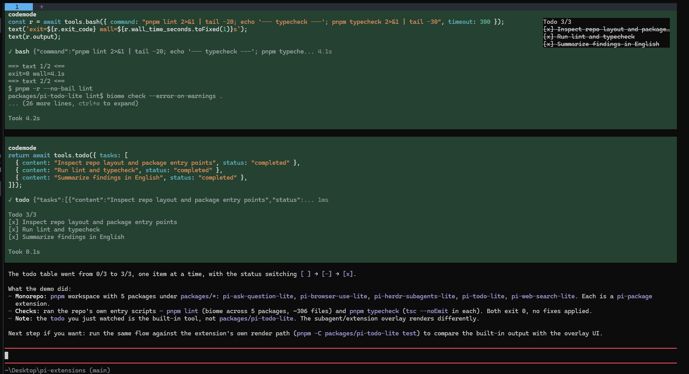

# pi-todo-lite



English | [简体中文](README.zh-CN.md)

The model keeps one ordered task table in a corner overlay. The table takes no lines from the chat, and it replays after compaction, after a branch switch or after `--continue`. The package has no runtime dependencies.

## Features

- The model side has one tool, `todo(tasks)`. The call submits the whole table and replaces the old table. `tasks: []` clears the table.
- Pending tasks take lines first. If the table passes `ui.widget.maxLines` lines, the rest collapse into `+N more`.
- `ui.mode` picks the display. `overlay` (default) puts the table in a corner overlay that never takes keyboard focus. `status` writes one line to the footer and shows the table only on `alt+t`.
- The overlay hides on narrow terminals and leaves one footer line instead. `ui.overlay` sets the anchor, the width, the margins and the width cutoff.
- `alt+t` folds the overlay down to one line (header plus the first in-progress task) and keeps the data. In `status` mode it opens and closes the table. `ui.widget` changes the glyphs, the header and the completed style.
- The extension adds four commands: `/todos`, `/todos clear`, `/todos export`, `/todos import <file>`.

## Install

```bash
pi install npm:pi-todo-lite
```

The old repository moved into this monorepo, so install from npm.

## Configuration

The config file is `<agent dir>/pi-todo/config.json`. `<agent dir>` is `$PI_CODING_AGENT_DIR`, or `~/.pi/agent` when unset. The directory is `pi-todo`, not the package name.

The extension only reads this file and never writes it. Without the file, all values are defaults.

An error names the absolute path and one `path: reason` line per fault. These cases throw: broken JSON, an unknown key, a wrong type, a wrong enum. An out-of-range number clamps to the bound.

**Minimal configuration**: zero config works. To make the table shorter, set `ui.widget.maxLines`. The default is 9 lines.

```json
{
  "ui": { "widget": { "maxLines": 5 } }
}
```

**Full configuration**: all keys follow, with their default values. `//` starts a comment; remove the comments in a real file.

```jsonc
{
  "tools": { "todo": { "name": "todo" } },           // tool name
  "plan": {
    "maxTasks": 20,                                  // max tasks per table. More fails the call
    "maxSubjectChars": 120,                          // max characters per task
    "requireSingleInProgress": false                 // true = only one in_progress task
  },
  "ui": {
    "mode": "overlay",                               // overlay (corner table) / status (one footer line)
    "widget": {
      "enabled": true,                               // draw the table at all
      "maxLines": 9,                                 // max lines (3–10)
      "showCompleted": true,                         // list completed tasks individually
      "header": "Todo {done}/{total} · {doing} doing", // header template: {done} {total} {doing}
      "glyphs": { "pending": "[ ]", "inProgress": "[-]", "completed": "[x]" }, // per-status glyphs
      "completedStyle": "strikethrough"              // strikethrough / dim / plain
    },
    "overlay": {
      "anchor": "top-right",                         // top-left … bottom-right (nine anchors)
      "width": 36,                                   // columns, or a percentage like "40%"
      "minTerminalWidth": 100,                       // narrower than this: hide, keep one footer line
      "margin": { "top": 1, "right": 2, "bottom": 3, "left": 1 } // insets from the terminal edge
    },
    "shortcut": { "toggle": "alt+t" }                // fold key. off = don't register
  },
  "lifecycle": { "onFinish": "clear" },              // model / keep / clear
  "commands": {
    "todos": { "enabled": true },                    // /todos
    "export": {
      "enabled": true,                               // /todos export
      "dir": "",                                     // output dir, empty = project root
      "fileNamePattern": "todo-{timestamp}.md"       // file name template. Never overwrites
    },
    "import": { "enabled": true }                    // /todos import <file>
  },
  "guidance": {                                      // what the model sees. Per-key override, empty values included
    "description": "…",                              // tool description. Empty = empty description
    "promptSnippet": "",                             // the tool-list line. Empty = omitted (same as missing)
    "promptGuidelines": ["…"]                        // guidelines. Empty array = omitted
  }
}
```

An unknown key throws; no key is ignored silently.

## Usage

A completed table stays on screen. The table clears when you send the next message. `lifecycle.onFinish` (`model` or `keep`) changes this behavior.

`/todos export` names the file after `commands.export.fileNamePattern`. On a name clash, `/todos export` yields and does not overwrite the file. `/todos import <file>` needs an empty table. Run `/todos clear` first.

`/todos` completes its arguments. Start typing `clear`, `export` or `import` and the list pops up. Press Tab to take the entry. After `/todos import `, the list shows the files and directories in the session directory. A directory ends with `/`. A path with spaces gets quotes.

Another extension may register `/todos` too, for example `@ssk_dev/rpiv-todo-lean`. Remove one of them. The tool name is configurable; the command name is not.

## Docs

| Document | Content |
|---|---|
| [ARCHITECTURE](docs/ARCHITECTURE.md) | Modules and dependency direction |
| [GLOSSARY](docs/GLOSSARY.md) | Terms |
| [Spec](docs/specs/0001-pi-todo-lite.md) | Contract and acceptance criteria |
| [Decisions](docs/decisions/) | One file per decision |
| [CHANGELOG.md](CHANGELOG.md) | Release notes |

## License

MIT © setwhite
