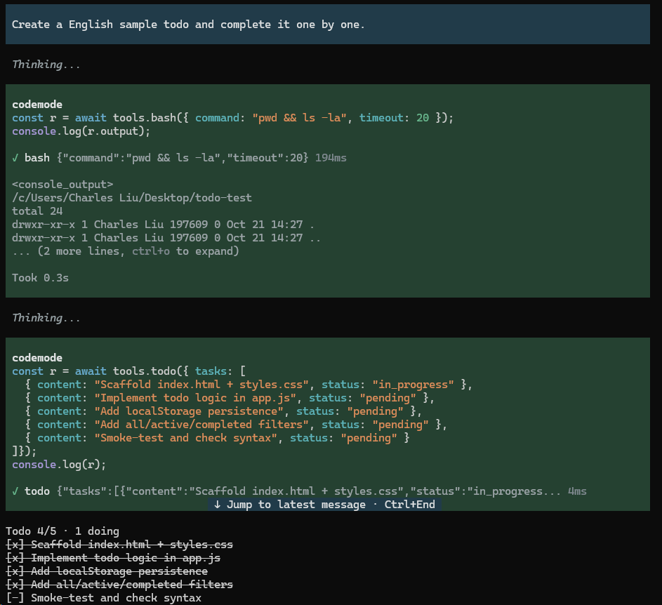

# pi-todo-lite

[English](README.en.md) | 简体中文



Pi 的 todo 扩展。模型维护一张有序任务表。表显示在输入框上方。compaction、切分支、`--continue` 之后，表照旧回放。零运行时依赖。

## 安装

用 npm 安装：

```bash
pi install npm:pi-todo-lite
```

本扩展已并入 [setwhite/pi-extensions](https://github.com/setwhite/pi-extensions)。pi 的 git 安装只认仓库根、无法指向子目录，所以只从 npm 安装；旧仓不再更新，`git:` 安装会停在最后发布的版本。

## 用法

模型侧只有一个工具 `todo(tasks)`。一次调用提交整张表，整表替换旧表。`tasks: []` 清空表。

表显示在输入框上方。行数超过 `ui.widget.maxLines` 时未完成项先占行，剩下的行按表序补已完成项，仍放不下才收成 `+N more`。按 `alt+t` 折叠表，任务数据不变。

整表完成后，表留在屏幕上。你发下一条消息时表清空。改 `lifecycle.onFinish` 可换这个行为。

命令：

- `/todos` 列出全部任务，不截断。
- `/todos clear` 清空表。
- `/todos export` 导出 markdown checklist。
- `/todos import <file>` 读回 markdown checklist。表必须为空；不为空时先运行 `/todos clear`。

## 配置

配置文件是 `<agent dir>/pi-todo/config.json`。`<agent dir>` 取 `$PI_CODING_AGENT_DIR`；未设置时取 `~/.pi/agent`。

扩展只读这个文件，从不写入。文件不存在时全部用默认值。

以下情况抛出错误，消息带绝对路径与逐条 `字段路径: 原因`：JSON 损坏、键名未知、类型或枚举错。数值越界时自动夹到上下限。

零配置即可用。只写要改的键：

```json
{ "ui": { "widget": { "maxLines": 5 } } }
```

全部键如下，值即默认值。`//` 只是注释；实际配置文件里删掉。

```jsonc
{
  "tools": { "todo": { "name": "todo" } },           // 工具名
  "plan": {
    "maxTasks": 20,                                  // 表里最多几条，超了这次调用失败
    "maxSubjectChars": 120,                          // 每条内容最长多少字符
    "requireSingleInProgress": false                 // true = 只准一条 in_progress
  },
  "ui": {
    "widget": {
      "enabled": true,                               // 显不显示这块
      "maxLines": 9,                                 // 最多几行（3–10）
      "placement": "aboveEditor",                    // aboveEditor / belowEditor
      "showCompleted": true,                         // 已完成的逐条列出
      "header": "Todo {done}/{total} · {doing} doing", // 表头模板，占位符 {done} {total} {doing}
      "glyphs": { "pending": "[ ]", "inProgress": "[-]", "completed": "[x]" }, // 三种状态的字形
      "completedStyle": "strikethrough"              // strikethrough / dim / plain
    },
    "shortcut": { "toggle": "alt+t" }                // 折叠键；off = 不注册
  },
  "lifecycle": { "onFinish": "clear" },              // model / keep / clear
  "commands": {
    "todos": { "enabled": true },                    // /todos
    "export": {
      "enabled": true,                               // /todos export
      "dir": "",                                     // 导出目录，空 = 项目根
      "fileNamePattern": "todo-{timestamp}.md"       // 文件名模板，同名让位不覆盖
    },
    "import": { "enabled": true }                    // /todos import <file>
  },
  "guidance": {                                      // 给模型看的文案；逐键覆盖，空值也覆盖
    "description": "…",                              // 工具描述；空串 = 空描述
    "promptSnippet": "",                             // 工具清单那行；空串 = 不出现（缺键同效）
    "promptGuidelines": ["…"]                        // guidelines；空数组 = 不出现
  }
}
```

未知键直接抛错，不会静默忽略。

## 开发

```bash
pnpm install               # 仓库根跑一次
pnpm lint
pnpm check:imports
pnpm typecheck
pnpm test
pi -ne -e ./src/index.ts   # 从工作区直接运行，不写 settings
```

CI、钩子、发版见[根 README](https://github.com/setwhite/pi-extensions#开发)。

## 文档

| 文档 | 什么时候看 |
|---|---|
| [`docs/specs/0001-pi-todo-lite.md`](docs/specs/0001-pi-todo-lite.md) | 契约：用户故事、验收标准（AC）、不做的。改这三样先改它 |
| [`docs/ARCHITECTURE.md`](docs/ARCHITECTURE.md) | 模块职责、依赖方向、不变量。加文件或改依赖前看它 |
| [`docs/GLOSSARY.md`](docs/GLOSSARY.md) | 术语。起名或文案打架时看它 |
| [`CHANGELOG.md`](CHANGELOG.md) | 每个已发布版本的用户可见变更。升级前看它 |

## License

MIT © setwhite
