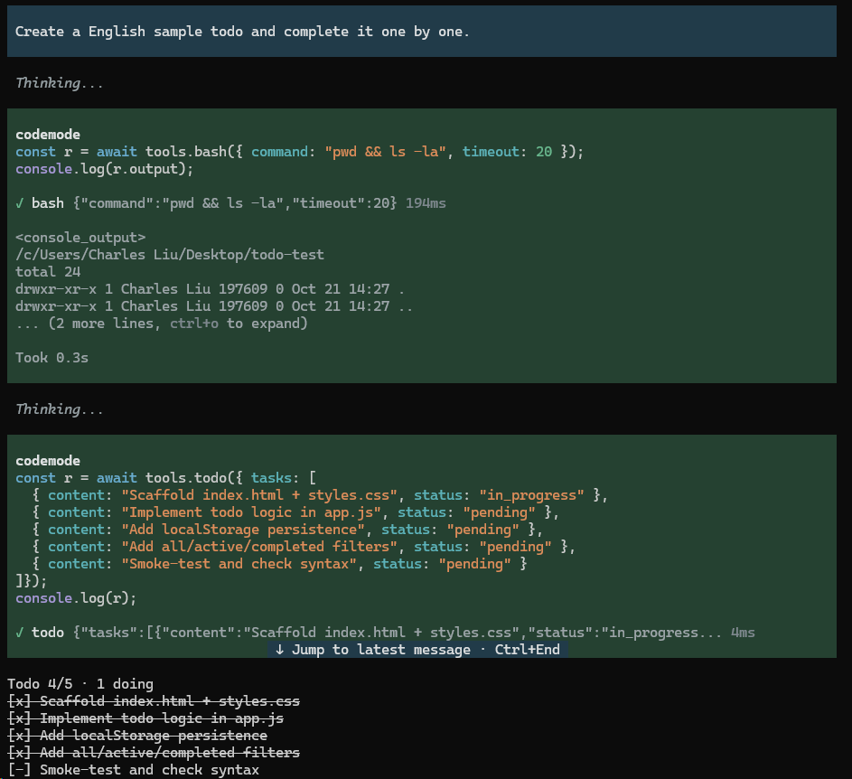

# pi-todo-lite

**[简体中文](README.zh-CN.md)** | [English](README.md)



模型维护一张有序任务表。任务表显示在输入框上方。compaction、切分支、`--continue` 之后表照旧回放。零运行时依赖。

## 功能

- 模型侧一个工具 `todo(tasks)`。一次提交整张表，整表替换旧表。`tasks: []` 清空表。
- 表在输入框上方。如果超过 `ui.widget.maxLines`，未完成项先占行。放不下才收成 `+N more`。
- `alt+t` 折叠表，任务数据不变。`ui.*` 可改位置、字形、表头与完成样式。
- 四个命令：`/todos`、`/todos clear`、`/todos export`、`/todos import <file>`。

## 安装

```bash
pi install npm:pi-todo-lite
```

旧仓已并入 monorepo。请用 npm 安装。

## 配置

配置文件是 `<agent dir>/pi-todo/config.json`。`<agent dir>` 取 `$PI_CODING_AGENT_DIR`。如果未设置，取 `~/.pi/agent`。

扩展只读这个文件，从不写入。如果文件不存在，全部用默认值。

以下情况抛出错误。消息带绝对路径与逐条 `字段路径: 原因`：JSON 损坏、键名未知、类型或枚举错。如果数值越界，自动夹到上下限。

**最小配置**：零配置即可用。如果要缩短表的行数，改 `ui.widget.maxLines`。默认 9 行。

```json
{
  "ui": { "widget": { "maxLines": 5 } }
}
```

**完整配置**：列出全部键，取值即默认值。`//` 只是注释。实际配置文件里删掉注释。

```jsonc
{
  "tools": { "todo": { "name": "todo" } },           // 工具名
  "plan": {
    "maxTasks": 20,                                  // 表里最多几条，超了这次调用失败
    "maxSubjectChars": 120,                          // 每条内容最长多少字符
    "requireSingleInProgress": false                 // true = 只准一条 in_progress
  },
  "ui": {
    "widget": {
      "enabled": true,                               // 显不显示这块
      "maxLines": 9,                                 // 最多几行（3–10）
      "placement": "aboveEditor",                    // aboveEditor / belowEditor
      "showCompleted": true,                         // 已完成的逐条列出
      "header": "Todo {done}/{total} · {doing} doing", // 表头模板，占位符 {done} {total} {doing}
      "glyphs": { "pending": "[ ]", "inProgress": "[-]", "completed": "[x]" }, // 三种状态的字形
      "completedStyle": "strikethrough"              // strikethrough / dim / plain
    },
    "shortcut": { "toggle": "alt+t" }                // 折叠键；off = 不注册
  },
  "lifecycle": { "onFinish": "clear" },              // model / keep / clear
  "commands": {
    "todos": { "enabled": true },                    // /todos
    "export": {
      "enabled": true,                               // /todos export
      "dir": "",                                     // 导出目录，空 = 项目根
      "fileNamePattern": "todo-{timestamp}.md"       // 文件名模板，同名让位不覆盖
    },
    "import": { "enabled": true }                    // /todos import <file>
  },
  "guidance": {                                      // 给模型看的文案；逐键覆盖，空值也覆盖
    "description": "…",                              // 工具描述；空串 = 空描述
    "promptSnippet": "",                             // 工具清单那行；空串 = 不出现（缺键同效）
    "promptGuidelines": ["…"]                        // guidelines；空数组 = 不出现
  }
}
```

未知键直接抛错，不会静默忽略。

## 用法

整表完成后，表留在屏幕上。发出下一条消息时清空表。`lifecycle.onFinish` 改成 `model` 或 `keep` 可换这个行为。

`/todos export` 按 `commands.export.fileNamePattern` 命名，同名让位不覆盖。`/todos import <file>` 要求表为空。如果表不为空，先 `/todos clear`。

## 文档

| 文档 | 内容 |
|---|---|
| [docs/specs/0001-pi-todo-lite.md](docs/specs/0001-pi-todo-lite.md) | 契约与验收 |
| [docs/ARCHITECTURE.md](docs/ARCHITECTURE.md) | 模块划分与依赖方向 |
| [docs/GLOSSARY.md](docs/GLOSSARY.md) | 术语表 |
| [CHANGELOG.md](CHANGELOG.md) | 发布记录 |

## License

MIT © setwhite
