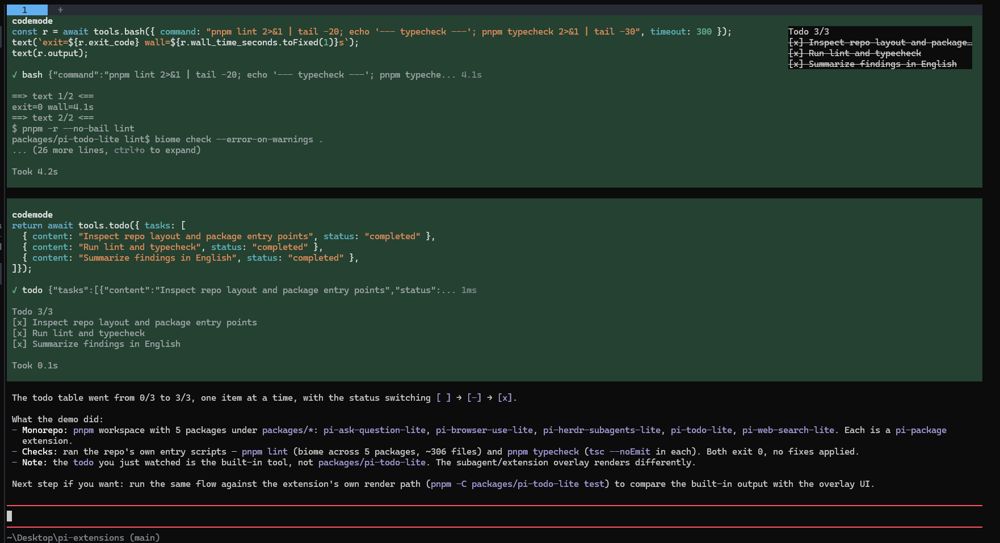

# pi-todo-lite

**[简体中文](README.zh-CN.md)** | [English](README.md)



模型维护一张有序任务表，表显示在角落浮窗里，不占对话行数。compaction、切分支、`--continue` 之后，表照旧回放。本包没有运行时依赖。

## 功能

- 模型侧只有一个工具 `todo(tasks)`。一次调用提交整张表，新表替换旧表。`tasks: []` 清空表。
- 未完成的任务先占行。表超过 `ui.widget.maxLines` 行时，余下的行收成 `+N more`。
- `ui.mode` 选展示方式。`overlay`（默认）把表放在角落浮窗里，永不抢键盘焦点。`status` 只在底栏写一行，按 `alt+t` 才弹出整张表。
- 终端太窄时浮窗自动隐藏，底栏留一行进度。`ui.overlay` 定角落位置、宽度、边距与这个宽度阈值。
- `alt+t` 把浮窗压成一行（表头加第一条进行中的任务），任务数据不变。`status` 档下它开关整张表。`ui.widget` 改字形、表头与完成样式。
- 扩展注册四个命令：`/todos`、`/todos clear`、`/todos export`、`/todos import <file>`。

## 安装

```bash
pi install npm:pi-todo-lite
```

旧仓已并入 monorepo，请从 npm 装。

## 配置

配置文件是 `<agent dir>/pi-todo/config.json`。`<agent dir>` 取 `$PI_CODING_AGENT_DIR`，未设置时取 `~/.pi/agent`。目录名是 `pi-todo`，不是包名。

扩展只读这个文件，不写。文件不存在时全部取默认值。

下列情况抛出错误：JSON 损坏、键名未知、类型错、枚举值错。消息带绝对路径，每个错误一行 `字段路径: 原因`。数值越界时夹到边界。

**最小配置**：零配置即可用。要缩短表，改 `ui.widget.maxLines`。默认 9 行。

```json
{
  "ui": { "widget": { "maxLines": 5 } }
}
```

**完整配置**：下面列出全部键，取值即默认值。`//` 只是注释。实际文件里删掉注释。

```jsonc
{
  "tools": { "todo": { "name": "todo" } },           // 工具名
  "plan": {
    "maxTasks": 20,                                  // 表里最多几条；超了这次调用失败
    "maxSubjectChars": 120,                          // 每条最长多少字符
    "requireSingleInProgress": false                 // true = 只准一条 in_progress
  },
  "ui": {
    "mode": "overlay",                               // overlay（角落浮窗）/ status（底栏一行）
    "widget": {
      "enabled": true,                               // 是否画这张表
      "maxLines": 9,                                 // 最多几行（3–10）
      "showCompleted": true,                         // 已完成的任务逐条列出
      "header": "Todo {done}/{total} · {doing} doing", // 表头模板，占位符 {done} {total} {doing}
      "glyphs": { "pending": "[ ]", "inProgress": "[-]", "completed": "[x]" }, // 三种状态的字形
      "completedStyle": "strikethrough"              // strikethrough / dim / plain
    },
    "overlay": {
      "anchor": "top-right",                         // 九宫格：top-left … bottom-right
      "width": 36,                                   // 列数，或百分比字符串如 "40%"
      "minTerminalWidth": 100,                       // 终端窄于此值就收起浮窗，底栏留一行
      "margin": { "top": 1, "right": 2, "bottom": 3, "left": 1 } // 离终端四边的距离
    },
    "shortcut": { "toggle": "alt+t" }                // 折叠键；off = 不注册
  },
  "lifecycle": { "onFinish": "clear" },              // model / keep / clear
  "commands": {
    "todos": { "enabled": true },                    // /todos
    "export": {
      "enabled": true,                               // /todos export
      "dir": "",                                     // 导出目录；空 = 项目根
      "fileNamePattern": "todo-{timestamp}.md"       // 文件名模板；同名不覆盖
    },
    "import": { "enabled": true }                    // /todos import <file>
  },
  "guidance": {                                      // 模型看到的文案；逐键覆盖，空值也覆盖
    "description": "…",                              // 工具描述；空串 = 空描述
    "promptSnippet": "",                             // 工具清单那一行；空串 = 不出现（缺键同效）
    "promptGuidelines": ["…"]                        // guidelines；空数组 = 不出现
  }
}
```

未知键直接抛错，不静默忽略任何键。

## 用法

整表完成后，表留在屏幕上。用户发出下一条消息时，表被清空。`lifecycle.onFinish` 改成 `model` 或 `keep` 可换这个行为。

`/todos export` 按 `commands.export.fileNamePattern` 命名文件。同名时 `/todos export` 让位，不覆盖。`/todos import <file>` 要求表为空。表不为空时，先跑 `/todos clear`。

`/todos` 有参数补全。开始输入 `clear`、`export` 或 `import` 时列表弹出。Tab 收下当前项。`/todos import ` 之后列会话目录下的文件与目录。目录带 `/`。带空格的路径自动加引号。

别的扩展也可能注册 `/todos`，例如 `@ssk_dev/rpiv-todo-lean`。两个都装时先卸一个。工具名可改，命令名不可改。

## 文档

| 文档 | 内容 |
|---|---|
| [ARCHITECTURE](docs/ARCHITECTURE.md) | 模块与依赖方向 |
| [GLOSSARY](docs/GLOSSARY.md) | 术语表 |
| [Spec](docs/specs/0001-pi-todo-lite.md) | 契约与验收 |
| [Decisions](docs/decisions/) | 一条决策一份文件 |
| [CHANGELOG.md](CHANGELOG.md) | 发布记录 |

## License

MIT © setwhite
