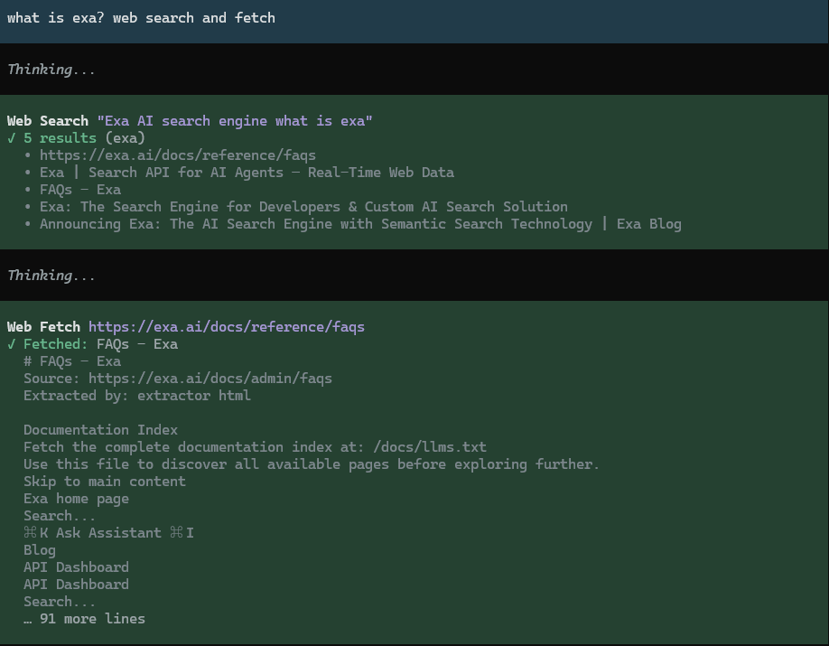

# pi-web-search-lite

[简体中文](README.zh-CN.md) | **English**



Two tools for pi: `web_search` finds pages. `web_fetch` extracts text from a page. Every request the extension makes uses one proxy setting.

## Features

- One search provider out of eight (tavily / brave / exa / firecrawl / perplexity / parallel / keenable / deepseek). The extension does not fall back to another provider.
- Fetching tries each entry of `fetch.extractors` in order. The default order is `html` → `jina`. Neither entry needs a key. GitHub pages go through `gh`, which is optional. Reddit only swaps in a redlib host.
- The extension rejects private and loopback addresses. The extension re-checks every redirect hop. The check reads the URL literal only. The check does no DNS lookup.
- The extension truncates oversize results. If `context.spillToFile` is true, the full text goes to a temp file and the path comes back for `read`.
- You can rename a tool, disable a tool or defer a tool. The built-in prompts are single-line English. `guidance` overrides any field.

## Install

```bash
pi install npm:pi-web-search-lite
```

The old repository moved into this monorepo. Install from npm.

## Configuration

One JSON file holds the configuration: `<PI_CODING_AGENT_DIR or ~/.pi/agent>/pi-web-search-lite/config.json`. Without the file, every value is the default. A wrong type, a wrong enum value or an unknown key fails startup and names the field. The extension clamps an out-of-range number. The `//` comments only explain. A real file must be strict JSON.

**Minimal configuration**: select one search provider and set the key of that provider. The default provider is tavily.

```json
{
  "provider": "exa",
  "apiKeys": { "exa": "your-key" }
}
```

You can also set keys in environment variables (`TAVILY_API_KEY` / `BRAVE_API_KEY` / `EXA_API_KEY` / `FIRECRAWL_API_KEY` / `PERPLEXITY_API_KEY` / `PARALLEL_API_KEY` / `KEENABLE_API_KEY` / `DEEPSEEK_API_KEY` / `JINA_API_KEY`). The environment variables win over the file. `WEB_SEARCH_PROVIDER` overrides `provider`.

**Full example**: all options follow, with comments. The key values, `userAgent`, `proxy` and the guidance fields are examples. All other values are the defaults.

```jsonc
{
  // Search provider: tavily | brave | exa | firecrawl | perplexity | parallel | keenable | deepseek. Override with the WEB_SEARCH_PROVIDER env var
  "provider": "tavily",
  // API keys: fill in the ones you need, or use environment variables (they win over the file)
  // Env vars: TAVILY_API_KEY / BRAVE_API_KEY / EXA_API_KEY / FIRECRAWL_API_KEY / PERPLEXITY_API_KEY / PARALLEL_API_KEY / KEENABLE_API_KEY / DEEPSEEK_API_KEY / JINA_API_KEY
  "apiKeys": {
    "tavily": "tvly-your-key",
    "brave": "your-key",
    "exa": "your-key",
    "firecrawl": "fc-your-key",
    "perplexity": "pplx-your-key",
    "parallel": "your-key",
    "keenable": "keen_your-key",
    "deepseek": "sk-your-key",
    "jina": "jina-your-key"
  },

  // Proxy: the single egress point for the extension's own requests. "" = direct. With a proxy set, a transport failure falls back to one direct attempt. After 3 failures in a row, the extension uses direct connections for 60 seconds and notes it in the result header. The gh subprocess also inherits the host's HTTP(S)_PROXY. Setting this writes the same variables
  "proxy": "",
  // Per-attempt timeout in milliseconds. The direct fallback gets its own budget
  "timeoutMs": 30000,
  // Outbound User-Agent: defaults to "<package>/<version>" when omitted
  "userAgent": "my-agent/1.0",

  // Tool switches and renaming. Rename to avoid a clash with other extensions
  "tools": {
    "web_search": { "enabled": true, "name": "web_search" },
    "web_fetch": { "enabled": true, "name": "web_fetch" }
  },
  // eager: tools always in context; deferred: discovered on demand via the host's tool_search, saving context
  "activation": "eager",

  // Override the built-in prompts. Omit to keep the built-in single-line English text. Fields per tool (web_search / web_fetch):
  //   description        tool description, part of the tool-search corpus. English recommended. "" = clear it
  //   promptSnippet      the one-line entry in the tool list. Not sent by default. "" = omit it from the list
  //   promptGuidelines   rules appended to the system prompt guidelines, array of strings. [] = add none
  "guidance": {
    "web_search": {
      "description": "Search the web; returns titles, URLs and snippets.",
      "promptSnippet": "Search the web",
      "promptGuidelines": ["web_search: cite sources as [Title](URL) links."]
    },
    "web_fetch": {
      "description": "Extract content of URL.",
      "promptSnippet": "Extract URL text",
      "promptGuidelines": ["web_fetch: use to get full text of a URL, e.g. docs or URLs found by web_search."]
    }
  },
  // The last gate before the model. Content beyond either cap is truncated. null = host defaults. Values above the host caps have no effect
  "context": {
    "maxInlineChars": null,  // byte cap (lower bound 1000. Smaller values are raised to 1000)
    "maxInlineLines": null,  // line cap (lower bound 50)
    "spillToFile": true      // on truncation, write the full text to <tmp>/pi-web-search-lite-*/web-{search,fetch}.md and return the path for read. false = the full text is dropped
  },
  // Search results: how many by default, and the ceiling
  "search": { "defaultMaxResults": 5, "maxResultsLimit": 10 },
  // Fetching: extractors form a chain. They are tried in order and the first usable body wins. A missing key, an error or a body under minChars falls through
  // Recommended order html → your provider → jina: html and jina need no key. tavily / exa / firecrawl / parallel / keenable / deepseek are both search providers and extractors
  "fetch": {
    "extractors": ["html", "jina"],
    "minChars": 200,
    "allowRaw": false,               // enables the raw argument (raw response, skipping the handler and the extractor chain)
    "maxCharsPerPage": 150000        // per-page body cap (GitHub handler excluded)
  },
  // Dedicated pages go to the matching handler first. github uses the gh output as is. reddit only swaps the host and hands off to the extractor chain. A skip (failure or disabled) falls through, and the reason goes to details.handlerSkips
  "handlers": {
    "github": {
      "enabled": true,     // false = never touch gh. GitHub URLs take the extractor chain
      "command": "gh",     // executed via execFile, no shell: an executable only (PATH name or absolute path), no arguments. .cmd/.bat fails on Windows
      "timeoutMs": 30000,  // per gh subprocess. The availability probe is cached per command inside the process, so /reload after a change
      "maxChars": 150000   // cap after the gh output is rendered to markdown
    },
    "reddit": {
      "enabled": true,    // false = no host substitution. reddit URLs take the extractor chain as-is. Turn it off if you do not want links handed to a third-party instance
      "baseUrl": "https://redlib.catsarch.com"  // reddit only swaps the host (the path is copied) for a redlib instance. The extractor chain still fetches the text. Point it at your own instance. Subpaths are fine
    }
  }
}
```

Every key is optional. `src/config/schema.ts` and `src/config/validate.ts` hold the ranges and the field semantics.

## Usage

The model calls both tools directly. No extra command is needed.

- `tools.*.name` renames a tool to avoid a clash. `enabled: false` turns a tool off.
- `activation: "deferred"` lets the host `tool_search` find the tools on demand. This setting saves context.
- `fetch.allowRaw: true` adds a `raw` argument to `web_fetch`. `raw` returns the raw response. `raw` skips the handler and the extractor chain, and only the `context.*` caps apply.
- Failures throw. The message names the field, the HTTP status or the timeout source. Skipped handlers and their reasons go to `details.handlerSkips`.

## Credits

| Project | Borrowed |
|---|---|
| [nicobailon/pi-web-access](https://github.com/nicobailon/pi-web-access) | The extractor chain and the dedicated page handlers |
| [juicesharp/rpiv-mono · rpiv-web-tools](https://github.com/juicesharp/rpiv-mono/tree/main/packages/rpiv-web-tools) | The thin provider layer and the prompt surface |

Both projects are open source. Thank you for the code.

## Docs

| Document | Content |
|---|---|
| [docs/adr/](docs/adr/) | Choices and what the extension does not do |
| [docs/ARCHITECTURE.md](docs/ARCHITECTURE.md) | Modules and dependency direction |
| [docs/GLOSSARY.md](docs/GLOSSARY.md) | Terms |
| [CHANGELOG.md](CHANGELOG.md) | Release notes |

## License

MIT, see [LICENSE](LICENSE).
