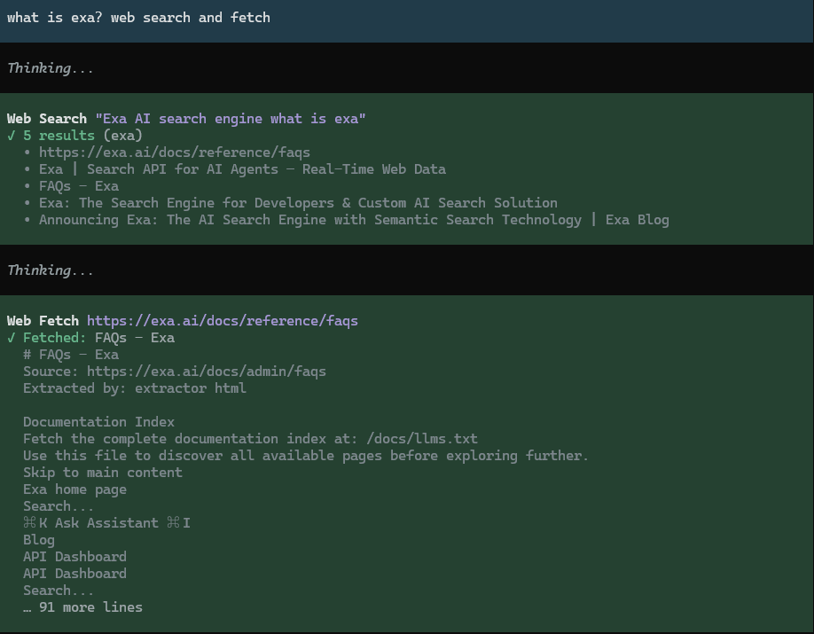

# pi-web-search-lite

**[简体中文](README.zh-CN.md)** | [English](README.md)



本扩展给 pi 两个工具：`web_search` 搜网页，`web_fetch` 抓正文。扩展自己的请求只经过一个代理配置点。

## 功能

- 搜索源八选一：tavily / brave / exa / firecrawl / perplexity / parallel / keenable / deepseek。不自动切换搜索源。
- 按 `fetch.extractors` 的顺序抓取，默认 `html` → `jina`，两者都不需要 key。
- GitHub 的仓库、文件、目录、issue、pull、release、commit、compare、actions run 页面走 `gh`，可选。其余 GitHub 页面走提取器链，原因记在 `details.handlerSkips`。
- reddit 只换 redlib 域名，正文仍由提取器链抓。
- 拒绝内网与回环地址，每一跳重定向都复查。判定只看 URL 字面量，不解析 DNS。
- 超过上限就截断。`context.spillToFile` 为真时，全文落临时文件，路径回填进结果，供 `read` 续读。
- 工具可改名、可关、可改成按需发现。`guidance` 可逐字段覆盖内置提示词。

## 安装

```bash
pi install npm:pi-web-search-lite
```

旧仓已并入 monorepo，请从 npm 装。

## 配置

配置只有一个 JSON 文件：`<PI_CODING_AGENT_DIR 或 ~/.pi/agent>/pi-web-search-lite/config.json`。文件不存在时全部取默认值。

类型错、枚举值错或未知键都会让启动失败，消息指出字段。数值越界 clamp 到允许区间。示例里的 `//` 只用于讲解，实际文件必须是严格 JSON。

**最小配置**：选择一个搜索源，填入这个搜索源的 key。默认搜索源是 tavily。

```json
{
  "provider": "exa",
  "apiKeys": { "exa": "你的key" }
}
```

key 也可以放在环境变量中：`TAVILY_API_KEY` / `BRAVE_API_KEY` / `EXA_API_KEY` / `FIRECRAWL_API_KEY` / `PERPLEXITY_API_KEY` / `PARALLEL_API_KEY` / `KEENABLE_API_KEY` / `DEEPSEEK_API_KEY` / `JINA_API_KEY`。环境变量优先于文件。`WEB_SEARCH_PROVIDER` 可临时覆盖 `provider`。

**完整示例**：下面列出全部配置项，每个键都有注释。除 key、`userAgent`、`proxy` 与 guidance 是示例值外，其余取值就是默认值。

```jsonc
{
  // 搜索源：tavily | brave | exa | firecrawl | perplexity | parallel | keenable | deepseek。可用 WEB_SEARCH_PROVIDER 环境变量覆盖
  "provider": "tavily",
  // API key：需要哪个源就填哪个键。也可以改用环境变量，环境变量优先
  // 环境变量名：TAVILY_API_KEY / BRAVE_API_KEY / EXA_API_KEY / FIRECRAWL_API_KEY / PERPLEXITY_API_KEY / PARALLEL_API_KEY / KEENABLE_API_KEY / DEEPSEEK_API_KEY / JINA_API_KEY
  "apiKeys": {
    "tavily": "tvly-你的key",
    "brave": "你的key",
    "exa": "你的key",
    "firecrawl": "fc-你的key",
    "perplexity": "pplx-你的key",
    "parallel": "你的key",
    "keenable": "keen_你的key",
    "deepseek": "sk-你的key",
    "jina": "jina-你的key"
  },

  // 代理：扩展自身请求的唯一出口。"" = 直连。有代理时先走代理。连不上时改直连，再试一次。连续 3 次失败后，60 秒内只直连，结果头会注明。gh 子进程另会继承宿主的 HTTP(S)_PROXY。配置了本项时，扩展写入同名变量
  "proxy": "",
  // 单次尝试的超时（毫秒）。代理连不上、改直连时，再等一份
  "timeoutMs": 30000,
  // 出站 User-Agent。不写则自动用「包名/版本」。写了就按写的发
  "userAgent": "my-agent/1.0",

  // 工具开关与改名。改成别的名字可避开与其它扩展重名
  "tools": {
    "web_search": { "enabled": true, "name": "web_search" },
    "web_fetch": { "enabled": true, "name": "web_fetch" }
  },
  // eager：工具常驻上下文。deferred：由宿主 tool_search 按需发现，更省上下文
  "activation": "eager",

  // 覆盖内置提示词。不配就用内置的英文单行。每个工具（web_search / web_fetch）可覆盖三个字段：
  //   description        工具描述。会进入工具检索的语料，建议英文。"" = 清空
  //   promptSnippet      工具列表里的一行短语。默认不发。"" = 不在工具列表里显示
  //   promptGuidelines   系统提示 Guidelines 区的规则，字符串数组。[] = 不追加
  "guidance": {
    "web_search": {
      "description": "Search the web; returns titles, URLs and snippets.",
      "promptSnippet": "Search the web",
      "promptGuidelines": ["web_search: cite sources as [Title](URL) links."]
    },
    "web_fetch": {
      "description": "Extract content of URL.",
      "promptSnippet": "Extract URL text",
      "promptGuidelines": ["web_fetch: use to get full text of a URL, e.g. docs or URLs found by web_search."]
    }
  },
  // 真正进模型的那道闸。内容超过任一上限就截断。null = 用宿主默认上限。写大于宿主上限的值不生效
  "context": {
    "maxInlineChars": null,  // 按字节截断（下限 1000。写小了会被抬到 1000）
    "maxInlineLines": null,  // 按行截断（下限 50）
    "spillToFile": true      // 截断时把完整文本写到 <tmp>/pi-web-search-lite-*/web-{search,fetch}.md，路径回填进结果供 read 续读。false = 全文丢弃
  },
  // 搜索条数：不传时给多少、最多允许多少
  "search": { "defaultMaxResults": 5, "maxResultsLimit": 10 },
  // 抓取：extractors 是提取器链。按顺序挨个试，第一个能用的胜出。缺 key、报错、正文太短都顺延下一个
  // 推荐顺序 html → 你的 provider → jina：html 与 jina 不需要 key。tavily / exa / firecrawl / parallel / keenable / deepseek 六家既是搜索源也是提取器
  "fetch": {
    "extractors": ["html", "jina"],
    "minChars": 200,
    "allowRaw": false,               // 打开后 web_fetch 才会多出 raw 参数（返回原始响应，跳过 handler 与提取器链）
    "maxCharsPerPage": 150000        // 单页正文上限（不含 GitHub handler）
  },
  // 专用页面优先交给对应 handler。github 直接用 gh 的输出。reddit 只换域名后交给提取器链。跳过（失败或关掉）时透明顺延，原因记在 details.handlerSkips
  "handlers": {
    "github": {
      "enabled": true,     // false = 完全不碰 gh。GitHub URL 走提取器链
      "command": "gh",     // execFile 直连、不经 shell：只能写可执行文件（PATH 名或绝对路径），不能带参数。Windows 上 .cmd/.bat 会失败
      "timeoutMs": 30000,  // 每个 gh 子进程的超时。可用性探测按 command 在进程内缓存，改完要 /reload
      "maxChars": 150000   // gh 输出渲染成 markdown 后的截断上限
    },
    "reddit": {
      "enabled": true,    // false = 不换域名。reddit URL 原样走提取器链。不想把链接交给第三方实例就关掉
      "baseUrl": "https://redlib.catsarch.com"  // reddit 只换域名（path 照抄）交给 redlib 实例，正文仍由提取器链抓。可填自建实例，带子路径也行
    }
  }
}
```

每个键都可省略。取值范围与字段语义见 `src/config/schema.ts` 与 `src/config/validate.ts`。

## 用法

模型直接调用这两个工具，不需要额外命令。

- `tools.*.name` 改名可避开与其它扩展重名。`enabled: false` 关掉工具。
- `activation: "deferred"` 交给宿主 `tool_search` 按需发现，节省常驻上下文。
- `fetch.allowRaw: true` 时，`web_fetch` 多出 `raw` 参数。`raw` 返回原始响应，跳过 handler 与提取器链，只过 `context.*` 截断。
- 失败一律抛错。消息指到字段、HTTP 状态或超时来源。被跳过的 handler 与原因记在 `details.handlerSkips`。

## 参考项目

| 项目 | 借鉴内容 |
|---|---|
| [nicobailon/pi-web-access](https://github.com/nicobailon/pi-web-access) | 提取器链、专用页面 handler 的思路 |
| [juicesharp/rpiv-mono · rpiv-web-tools](https://github.com/juicesharp/rpiv-mono/tree/main/packages/rpiv-web-tools) | 薄 provider 层、提示词配置面 |

两个项目都是开源的。本扩展建在它们之上，谢谢作者。

## 文档

| 文档 | 内容 |
|---|---|
| [ARCHITECTURE](docs/ARCHITECTURE.md) | 模块划分与依赖方向 |
| [GLOSSARY](docs/GLOSSARY.md) | 术语表 |
| [Modules](docs/modules/) | 每个模块的取舍与坑 |
| [ADR](docs/adr/) | 选型与「不做什么」 |
| [CHANGELOG.md](CHANGELOG.md) | 发布记录 |

## License

MIT，见 [LICENSE](LICENSE)。
